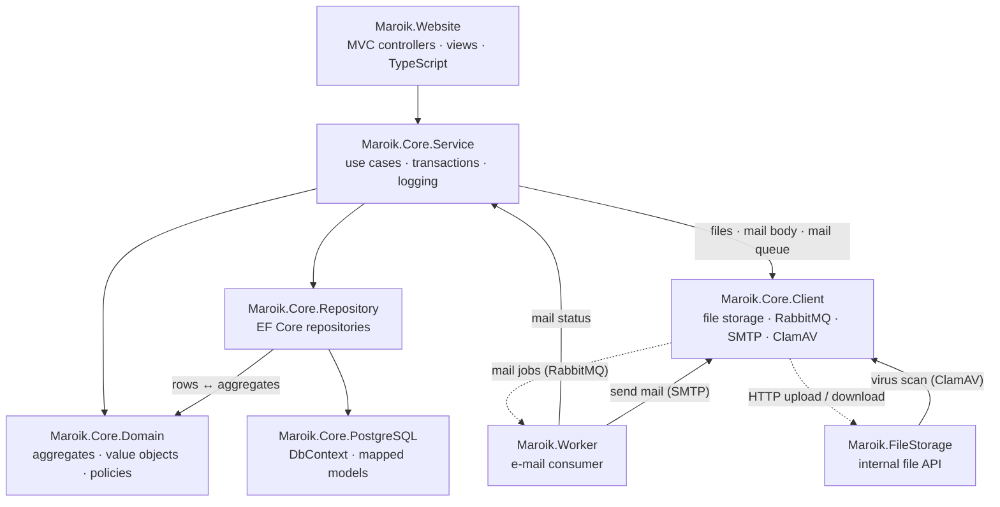
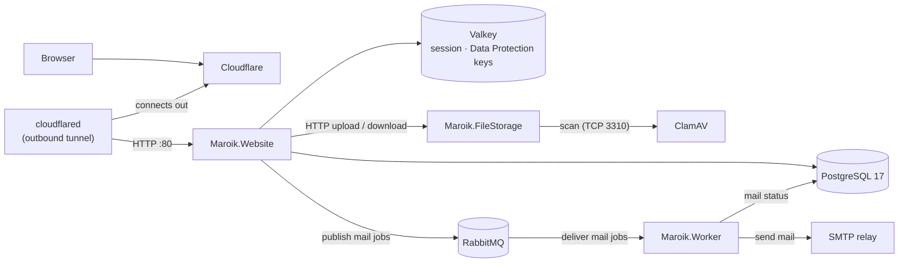

# Maroik

# [https://www.maroik.com]

# Contact: admin@maroik.com

## Introduction
Maroik is a modern web application built with ASP.NET Core MVC, featuring a comprehensive set of tools for personal and business management. It includes features such as expense tracking, calendar management, bulletin boards, and role-based user management.

- Domain Registrar: AWS Route 53 Domains
- DNS: Cloudflare DNS
- DDoS Protection / Web Proxy / Tunnel: Cloudflare
- Incoming Email: Zoho Mail
- Outgoing Email / SMTP: Brevo

## Key Features

### 1. Personal Finance Management
- Expense tracking and categorization
- Income recording
- Fixed (recurring) income and expenditure with deposit-day reminders — the next deposit is found across the year end (e.g. 28 Dec → 2 Jan), and a 29 February schedule is skipped in common years
- Amounts are kept exactly to four decimal places (`numeric(20,4)`); a fifth decimal is rejected instead of silently rounded, so no recorded amount is ever changed by rounding
- Every income and expenditure updates its asset's balance in the same transaction, under a row lock, so concurrent records never lose an update; the balance can also be corrected by hand when editing the asset- Financial reports and analytics
- Export to Excel — amounts as numeric cells (they sum and sort in Excel), timestamps as `yyyy-MM-dd HH:mm:ss` in the viewer's time zone

### 2. Calendar and Schedule Management
- Monthly calendar view
- Event creation and management, with a file attachment and inline images per event
- Calendars shared with other users or the public

### 3. Bulletin Board System
- Post creation, editing, and deletion
- Comment system
- File attachments, downloaded through a separate access-checked POST action and streamed — the post page itself carries only the file's name and size
- Rich-text editor images, embedded in the post when it is viewed
- Search functionality

### 4. User Management
- Role-based access control (Admin/User)
- User profile management, including an avatar
- Session-based authentication
- Password management (registration confirmation, password reset, forced password change)
- E-mail addresses are matched trimmed and case-insensitively at login, password reset and confirmation resend
- Privacy: uploaded avatars and editor images are re-encoded without their metadata (EXIF GPS position, camera model, capture time), after first being turned upright by their EXIF orientation

### 5. Admin Dashboard
- User management — role change, lock/unlock, e-mail confirmation, terms agreement, soft delete/restore, password reset with a forced change at next login; role, lock and delete changes are audit-logged with the acting admin
- Navigation menu management (the menu doubles as the access-control list)
- Account export to Excel without password hashes or registration/reset tokens
- Analytics dashboard

### Error messages
- A refused write shows its actual reason, localized in English and Korean (e.g. "Only zip extension allowed.", "Cannot add a comment to a locked post.", "Role must be Admin, User or Anonymous.").
- A server-side fault (database, file storage) shows "A temporary error occurred. Please try again later." instead of blaming the user's input; the exception is logged once, where it is handled.

## Engineering Highlights
- **DDD + Clean Architecture, enforced by tests.** Dependencies point Website → Service → Domain; NetArchTest rules fail the build when a layer reaches the wrong way, when the domain logs, reads the clock, or builds an error outside `DomainError`, and when a project is missing from the solution.
- **Deterministic time.** Domain methods take the current time as a `DateTime utcNow` argument; each use case reads `TimeProvider` once and passes the same instant everywhere, so `Created == Updated` on creation and token expiry is tested at its exact boundaries with `FakeTimeProvider`.
- **Rich domain model.** Value objects (`Email`, `Money`, `CurrencyCode`, `AccountRole`, …) replace primitive strings; admin actions are intent-revealing aggregate operations (`ChangeRole`, `Lock`/`Unlock`, `ForceConfirmEmail`/`RevokeEmailConfirmation`, `AcceptServiceTerms`/`RevokeServiceTerms`, `SoftDelete`/`Restore`, `AdminResetPassword`) instead of a field-overwriting update.
- **Use-case DTOs.** Self-registration, admin account creation and admin account update each have their own request type, so a registration form can never carry a role, lock or confirmation flag.
- **Test-first development.** Every change starts with a failing test, including the log entries it must write; real PostgreSQL and RabbitMQ run in Testcontainers instead of mocks wherever the behaviour depends on them.

## Development Timeline
Maroik has been built by one developer since May 2021. It was developed in a private repository until September 2026, when the project moved to this public repository; all development now happens here. The earlier history — about 4,300 commits — stays in the private repository; those commits show on the contribution graph of the [author's GitHub profile](https://github.com/IkhyeonJo).

| When | Milestone |
|---|---|
| 2021-05 | Project starts as *MyLaboratory*: ASP.NET Core (2.1 → .NET 5) with MariaDB, run under docker-compose from the first week |
| 2021-06 | AdminLTE 3 layout, NonFactors MVC grid |
| 2021-07 | Excel export, registration with e-mail confirmation, password reset, separate admin / user dashboards, English / Korean localization (resx) |
| 2021-08 | Account book: assets, income, expenditure, fixed income / expenditure with deposit-day notices |
| 2021-12 | MariaDB 10.6 |
| 2022-07 | User dashboard backend and charts for income and expenditure |
| 2022-08 | Public anonymous dashboard and landing pages; role-based navigation menu (Admin / User / Anonymous) stored in the database |
| 2022-09 | .NET 6 |
| 2022-10 | Renamed to **Maroik**; Free Forum with Summernote editor and HTML sanitizing |
| 2022-11 | Forum comments, locked and notice posts; security headers |
| 2023-03 | .NET 7 |
| 2023-04 | Income and expenditure statistics |
| 2023-08 | Global AJAX error handling; debugging docker-compose in VS Code |
| 2024-02 | .NET 8; dashboard breakdowns of each income / expenditure class |
| 2024-04 – 09 | Calendar (FullCalendar): calendars, events, reminders, sharing, browsing others' calendars |
| 2024-05 | Private notes, per-account time zones, default monetary unit, dashboard year / month selection |
| 2024-09 | Maroik.FileStorage service |
| 2025-01 | Attachments and inline images for forum posts, calendar events and private notes; server resource monitoring on the admin dashboard; Let's Encrypt certificates renewed automatically with Certbot |
| 2025-03 | .NET 9 |
| 2025-04 | MariaDB → PostgreSQL |
| 2025-05 | DNS moved from AWS Route 53 to Cloudflare; ClamAV virus scanning of uploads; public demo account |
| 2025-07 | Database transactions for account-book writes |
| 2025-08 | BCrypt password hashing |
| 2025-11 | .NET 10; data access split into repositories and clients |
| 2025-12 | Project split into Core layers (Repository, Service, Client, PostgreSQL) |
| 2026-04 | Maroik.Core.Contract; first unit tests |
| 2026-05 – 08 | DDD + Clean Architecture refactor, ending with the Maroik.Core.Domain project; CI/CD with a coverage gate; Serilog |
| 2026-07 | Valkey (replacing Redis), RabbitMQ and the Maroik.Worker mail service |
| 2026-09 | Client scripts migrated to TypeScript; repository and E2E tests on real PostgreSQL (Testcontainers); a series of whole-solution reviews fixing race conditions and security gaps; strict TDD and logging rules; mutation testing (Domain 78 % → 92 %) |
| 2026-09-28 | Moved from the private repository to this public repository, where all development continues |
| 2026-10 | Service mutation score 70 % → 96 %; TLS ended at Cloudflare through a Cloudflare Tunnel; RSA replaced with ASP.NET Core Data Protection; memory-safety, logging-template, security and banned-API analyzers as build errors; admin and menu safeguards against locking administrators out |

## Architecture

### Layers — DDD + Clean Architecture

Solid arrows show which project calls which, always through an interface in `Maroik.Core.Contract`
(interfaces and DTOs only, so it calls nothing and is not drawn). The Website calls the Service layer and nothing
else. Maroik.Worker and Maroik.FileStorage are separate processes: when a use case sends mail or stores a file,
the Service hands it to Client, and Client puts the mail job on RabbitMQ for the Worker (which sends it over SMTP)
or uploads / downloads the file over HTTP to FileStorage — the dotted lines. Repository and Client implementations
are registered only in each host's composition root (`Program.cs`, `WorkerHost`), never called from controllers,
views or handlers.



- **Domain** holds the business rules — aggregates, value objects (`Email`, `Money`, `CurrencyCode`, …) and policies
  (finance class taxonomies, reminder limits, fixed schedules, passwords, image uploads). It calls no other
  project, logs nothing, never reads the clock (the current time is passed in) and reports every error through
  `DomainError`, so the outer layers can translate it.
- **Service** orchestrates a use case: it loads aggregates through repository interfaces, calls domain methods, owns
  the transaction (each write spells out `BeginAsync` / `CommitAsync` / `RollbackAsync`), maps to DTOs and logs. It
  calls Repository and Client only through their Contract interfaces.
- **Repository** (EF Core) and **Client** (file storage over HTTP, RabbitMQ publishing, SMTP, ClamAV) implement the
  Contract interfaces. Website controllers and views never call them; the Worker calls the SMTP client itself and
  FileStorage calls the ClamAV client itself.
- **Website** controllers bind the request, call a service and return the view model or a `{ result, error }`
  JSON reply; views only render. The navigation menu doubles as the access-control list (`AuthorizationFilter`).
- **No business logic on the client.** The client scripts do DOM wiring and AJAX only; a rule the UI mirrors comes
  from a domain policy serialized into the page, and the server re-validates every write.

All of this is enforced by architecture tests that fail the build, among them:
`Domain_ShouldNot_DependOnAnyOtherLayer`, `Domain_ShouldNot_Log`, `Domain_ShouldNot_ReadTheClock`,
`Domain_ErrorMessages_MustGoThrough_DomainError`, `BoundedContext_ShouldNot_DependOnAnotherBoundedContext`,
`ServiceLayer_MustNotProjectReference_AnyInfrastructureOrPersistenceProject`,
`InfrastructureLayers_MustBuildOnContractOnly_NotOnEachOtherOrService`, `ProjectReferenceGraph_MustBeAcyclic`,
`Controllers_ShouldNot_DependOnRepositoryOrClientOrServiceNamespace`,
`PostActions_MustCarry_AntiforgeryAndRoleAttributes` and `ServiceResults_TakeTheirMessageKey_FromServiceErrorKeys`.

### Runtime



Every service runs as a container under Docker Compose. Uploads are scanned by ClamAV before they are stored, the
file storage is reachable only on the internal network, and outgoing mail is queued in RabbitMQ and sent by the
worker. In production the site is reached through a Cloudflare Tunnel, so the host publishes no port.

### Client scripts

The page scripts are written in **TypeScript** (`Maroik.Website/TypeScripts/**/site.ts`) and compiled 1:1 by `tsc`
into plain global scripts — no bundler, no runtime framework. They are type-checked with `strict` plus
`noUncheckedIndexedAccess`, `exactOptionalPropertyTypes` and the other strict options, and contain **no `any` and no
type assertion**. Anything the compiler cannot prove is checked at run time instead: each role's layout script
provides a small toolkit (`fieldValue`, `parseJson`, `byId`, `required`, `onReply`, …), every AJAX reply is
validated against a check that mirrors the controller's JSON field for field, and a reply of the wrong shape shows a
generic error instead of failing half-way through a handler.

## Technologies Used

### Backend
- ASP.NET Core MVC 10.0
  - Improved performance
  - Enhanced routing
  - Better dependency injection
- PostgreSQL 17
- Entity Framework Core 10.0
  - Improved query performance
  - Better async support
  - Enhanced change tracking
- Docker
  - Multi-stage builds
  - Container orchestration
  - Environment isolation
- Authentication & Authorization
  - Session Authentication
  - Role-based access control
- Cross-Origin Resource Sharing (CORS)
- Magick.NET — image validation and metadata stripping
- DocumentFormat.OpenXml — Excel export

### Frontend
- AdminLTE 3.1.0
- Bootstrap 4.6.0
- jQuery 3.6.0
- HTML5/CSS3
- JavaScript ES2024
- TypeScript 7.0
  - The custom client scripts are authored in TypeScript at `Maroik.Website/TypeScripts/{admin,anonymous,user}/custom/**/site.ts` and compiled 1:1 by `tsc` to `Maroik.Website/wwwroot/**/custom/**/site.js` (no bundler, no Babel). The release build (`npm run build`, used by the Docker image) then minifies each `site.js` in place with terser; `npm run build:debug` leaves it readable with a source map.
  - Compiled under `--strict`; each file is an IIFE-wrapped global script (no `import`/`export`).
  - Scripts keep only DOM wiring, widget init, AJAX transport, and notifications — business logic lives in `Maroik.Core.*` (DDD + Clean Architecture). Client-side rule checks are UX mirrors; the server always re-validates.
  - `wwwroot/**/site.js` is build output and git-ignored. Docker Compose builds generate it in the Dockerfile's Node stage; running the site on the host, or running the client-script tests, needs Node 22 + `npm ci` in `Maroik.Website/`.
  - MSBuild runs `tsc` on `dotnet build` when `node_modules/` is present; Docker builds run it in a dedicated `node:22-alpine` stage.
  - Unit-tested with Vitest + jsdom in `Maroik.Website/TypeScripts.Tests/` (one `*.test.ts` per script, exercising the compiled `site.js`).
  - Details: `Maroik.Website/TypeScripts/README.md`.
- NonfactorGrid
- Chart.js 2.9.4
- Font Awesome 5.15.3
- Summernote 0.8.18
- FullCalendar 5.5.1
- jQuery UI 1.12.1
- jquery-confirm 3.3.4
- toastr 2.1.4
- Moment.js 2.30.1

### Development Tools
- Visual Studio
- JetBrains Rider
- Git
- Docker Compose
- Postman

## Naming Conventions
- Code projects (assemblies, namespaces, types) follow the .NET Framework Design Guidelines for acronym casing: acronyms of three or more letters use PascalCase (e.g. `Ssl`, `Http`), while two-letter acronyms stay uppercase (e.g. `DB`, `IO`).
- Operational folders that are not code projects — `Maroik.SSL`, `Maroik.DB`, `Maroik.Log`, `Maroik.Crontab`, `Maroik.DeployOps` — intentionally keep their existing casing. These names are referenced by docker-compose volume mounts, deployment scripts, and live directories on the production server, so they are kept stable by design rather than renamed for stylistic consistency.

## Testing Strategy

The goal is that a test fails whenever the behaviour it describes breaks — not that lines are merely executed.

- **Test-first.** Every change starts with a failing test, a bug fix with a regression test that fails on the old
  code, and the log entries a use case must write are asserted like any other result.
- **Real dependencies where the behaviour depends on them.** Repositories run against a real PostgreSQL 17 loaded
  with the production schema and seed data (Testcontainers, one throwaway database per test class); messaging against
  a real RabbitMQ 4; mail against an in-process SMTP server; controllers through `WebApplicationFactory` against a real
  database; and the whole site in a real browser with Playwright.
- **Mocks only at layer boundaries.** Service tests mock the repositories but assert the transaction calls
  (`BeginAsync` / `CommitAsync` / `RollbackAsync`), the exact error code / key / type, and every `catch`'s log entry.
- **Contracts between the layers are tested.** The EF model is compared with the SQL schema
  (`ModelMatchesSchemaTests`); every message key a controller can receive must exist in its `en-US` and `ko-KR`
  resources (`ServiceErrorKeyResxTests`); every localized text a page script reads must be rendered by its view.
- **Architecture as tests.** The layering rules above, the project-reference graph and the controller conventions
  fail the build when broken.
- **Client scripts run as shipped.** Vitest + jsdom run the *compiled* `site.js` together with the real layout
  script, against fixtures that carry what the real views and replies carry. Guard tests keep `any` and type
  assertions out of the TypeScript, and a compile probe proves that untyped library values are rejected.
- **Stylesheets are checked as the browser applies them.** `StylesheetFlowTests` read the computed style of the
  elements each of the site's own CSS rules targets on the real pages, after the AdminLTE / Bootstrap / FullCalendar
  stylesheets they override, so a rule that is removed, outranked or no longer loaded fails a test.
- **Quality gates.** Line coverage >= 80 %, branch coverage >= 65 %, zero build warnings, and on-demand mutation
  testing with Stryker.NET (Domain 96 %, Service 96 %, measured 2026-10-13 — the survivors left are equivalent mutants
  or ones the MTP runner miscounts inside static field initializers).

### Test projects
Every source project has a matching `*.Tests` project (xUnit v3 on Microsoft.Testing.Platform), plus the client-script suite and an end-to-end suite. `Maroik.sln` builds them all; CI runs each with coverage (`.github/workflows/ci.yml`, gate: line >= 80 %, branch >= 65 %).

| Tests | What they cover | Needs Docker |
|---|---|---|
| `Maroik.Core.Domain.Tests`, `Maroik.Core.Contract.Tests` | entities, policies, value objects, DTOs, the layering / package-reference architecture rules | no |
| `Maroik.Core.Service.Tests` | use-case orchestration (mocked repositories) | no |
| `Maroik.Core.Repository.Tests` | EF Core repositories against a real PostgreSQL 17 loaded from `Maroik.DB/.../Debugging/Init.sql` | yes |
| `Maroik.Core.PostgreSQL.Tests` | the EF model against the real schema of both init scripts (tables, columns, keys, foreign keys, indexes) | yes |
| `Maroik.Core.Client.Tests` | mail (in-process SMTP server), file storage, ClamAV, RabbitMQ publisher and health check (real RabbitMQ) | yes |
| `Maroik.Worker.Tests` | the e-mail consumer and the worker host, against a real RabbitMQ and an SMTP relay | yes |
| `Maroik.FileStorage.Tests` | the file-storage service | no |
| `Maroik.Website.Tests` | controllers, filters, views and start-up through `WebApplicationFactory` against a real PostgreSQL | yes |
| `Maroik.Website/TypeScripts.Tests` | every client script (Vitest + jsdom), run with `npm test` in `Maroik.Website/` | no |
| `Maroik.E2E.Tests` | the running site in a real browser (Playwright), including the computed styles of the site's own stylesheets over the vendor CSS | yes |

```bash
dotnet build Maroik.sln -p:RunClientScriptTests=false
dotnet test --project Maroik.Core.Service.Tests            # any single project
(cd Maroik.Website && npm ci && npm test)                  # client scripts
```

## Getting Started

### Prerequisites
- .NET 10.0 SDK
- Docker and Docker Compose
- Visual Studio (Windows) or JetBrains Rider (Linux/Mac)

### Running the Project

#### Windows
1. Install Visual Studio
2. Open Maroik.sln
3. Set docker-compose as startup project
4. Press F5 to run in debug mode

#### Linux/Mac
1. Install JetBrains Rider
2. Open Maroik.sln
3. Start debug mode with docker-compose.debug.yml

## Deployment

### Ubuntu Server 24.04.4
1. Configure .env.prod with domain name and mail settings
2. Set email credentials in DBBackup.sh and UploadFileBackup.sh
3. Copy Maroik folder to /home/ubuntu/
4. Run Deploy.sh script

## Screenshots

### Login


### User Dashboard


### Calendar


### Forum


### NonfactorGrid


### User Profile


## Contributing
1. Fork the repository
2. Create your feature branch (`git checkout -b feature/AmazingFeature`)
3. Commit your changes (`git commit -m 'Add some AmazingFeature'`)
4. Push to the branch (`git push origin feature/AmazingFeature`)
5. Open a Pull Request

## Support
For issues and questions, please use the GitHub issue tracker.

## License
This project is licensed under the MIT License - see the [LICENSE](LICENSE) file for details.

## Special Notes
- Mail account configuration is required for deployment.
